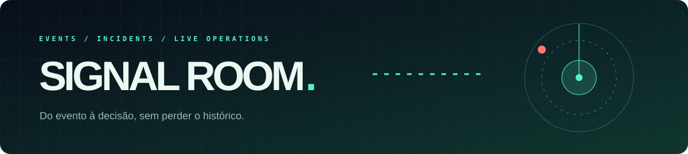

<p align="center"></p>

# Signal Room

Um painel de incidentes orientado a eventos. O monitoramento envia um evento assinado; o servidor valida, grava em log append-only e reconstrói a visão atual sem sobrescrever a história. O navegador recebe a atualização por SSE, sem polling.

Desenvolvi este projeto para mostrar a parte que costuma ficar invisível em dashboards: contrato de entrada, deduplicação, persistência, replay e estados coerentes depois de reiniciar o serviço.

## O que dá para explorar

- Incidentes abertos, reconhecidos e resolvidos, com contadores e filtro no painel.
- Ingestão HMAC-SHA256, ID idempotente por evento e limite de 64 KiB por payload.
- Log NDJSON, fila de gravação serializada e projeção reconstruída no boot.
- Atualização ao vivo por Server-Sent Events com heartbeat e reconexão do navegador.
- UI responsiva, estados vazios, foco visível e respeito a `prefers-reduced-motion`.
- Testes de domínio, persistência, assinatura e API, sem dependências de terceiros.

## Rodar

Requer Node.js 24 LTS. Não há `npm install` porque o projeto usa apenas módulos nativos.

```bash
export INGEST_KEY='troque-por-uma-chave-aleatoria-longa'
node src/server.mjs
```

No PowerShell: `$env:INGEST_KEY='troque-por-uma-chave-aleatoria-longa'`. Abra `http://127.0.0.1:3000`. Em outro terminal com a mesma chave, rode `node scripts/demo.mjs` para gerar uma sequência demonstrativa. Os eventos da demo também são persistidos em `data/events.ndjson`, ignorado pelo Git.

```bash
node --test
```

Configure `HOST`, `PORT` e `DATA_FILE` via ambiente. O servidor usa `127.0.0.1` por padrão. Para acesso remoto, use proxy HTTPS e controle de acesso para o painel; a chave de ingestão não deve ser exposta ao browser nem commitada. Em implantação com múltiplas instâncias, substitua o arquivo local por um storage compartilhado transacional: o log NDJSON é propositalmente single-writer.

## Contrato de ingestão

`POST /api/events` recebe JSON com `eventId`, `incidentKey`, `service`, `source`, `severity` (`critical|high|medium|low`), `kind` (`triggered|acknowledged|resolved`), `summary` e `occurredAt` ISO-8601. O header `X-Signal-Signature` contém `sha256=` + HMAC hexadecimal dos bytes exatos do corpo, usando `INGEST_KEY`. IDs repetidos retornam `200` com `duplicate: true`; um evento novo retorna `201`.

```text
Monitor → HMAC → validação → log append-only → projeção → SSE → painel
```

`GET /api/health` e `GET /api/incidents` permitem integração sem abrir o painel. Um evento de atualização sem abertura prévia é ignorado pela projeção; o log preserva o registro recebido para auditoria. Este é um laboratório operacional, não um substituto pronto para um sistema distribuído de incidentes: falta autenticação do painel, retenção/compactação e coordenação multi-instância.

## Deploy e reversão

Execute `node --test` na pipeline, defina `INGEST_KEY` via secret e monte um volume persistente no diretório `data/`. Para voltar à versão anterior, reverta o commit e reinicie; o formato do log permanece NDJSON e eventos já gravados não são apagados. Faça backup do volume antes de mudanças futuras no contrato de evento.

---

<p align="center"><br><strong>Luis da Silva</strong><br>Back-end, dados e automações em produção.</p>
